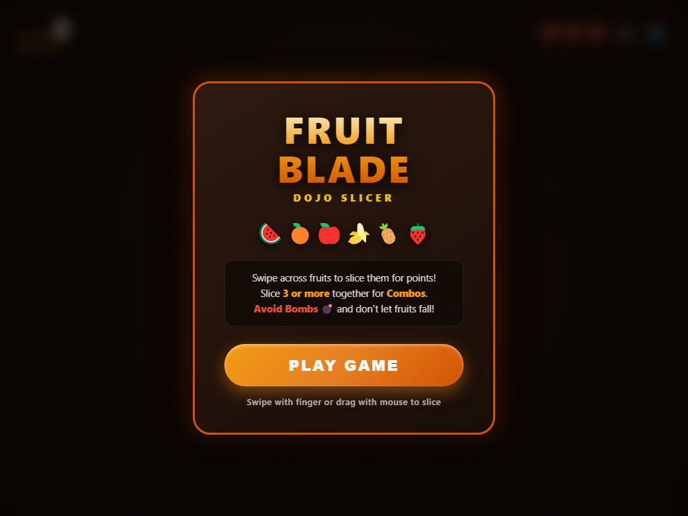
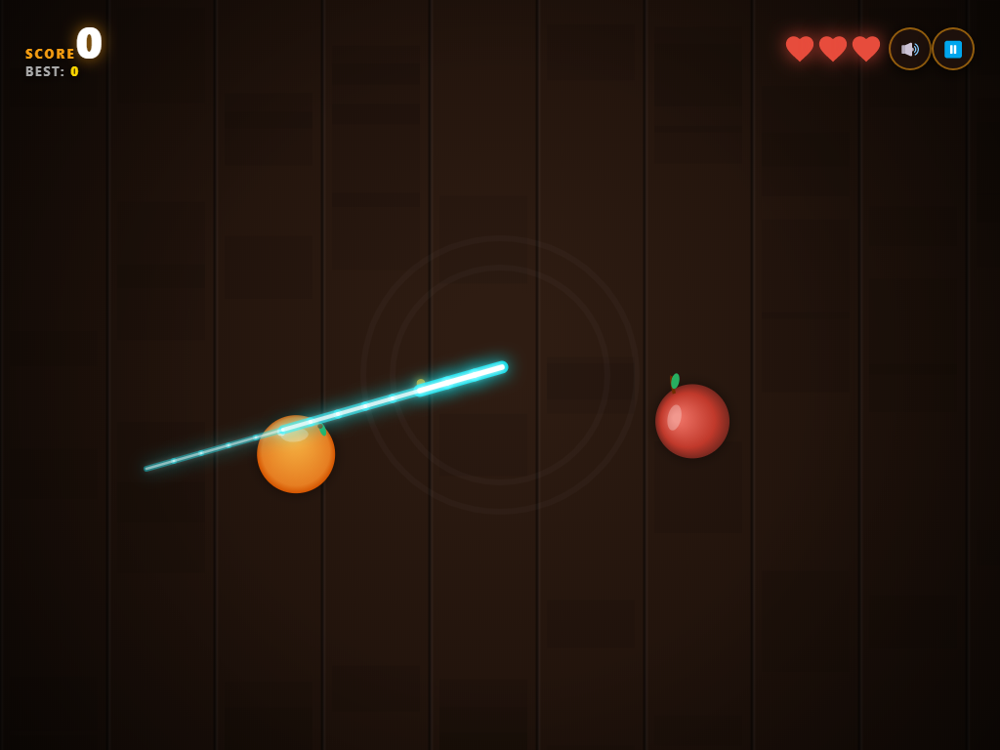
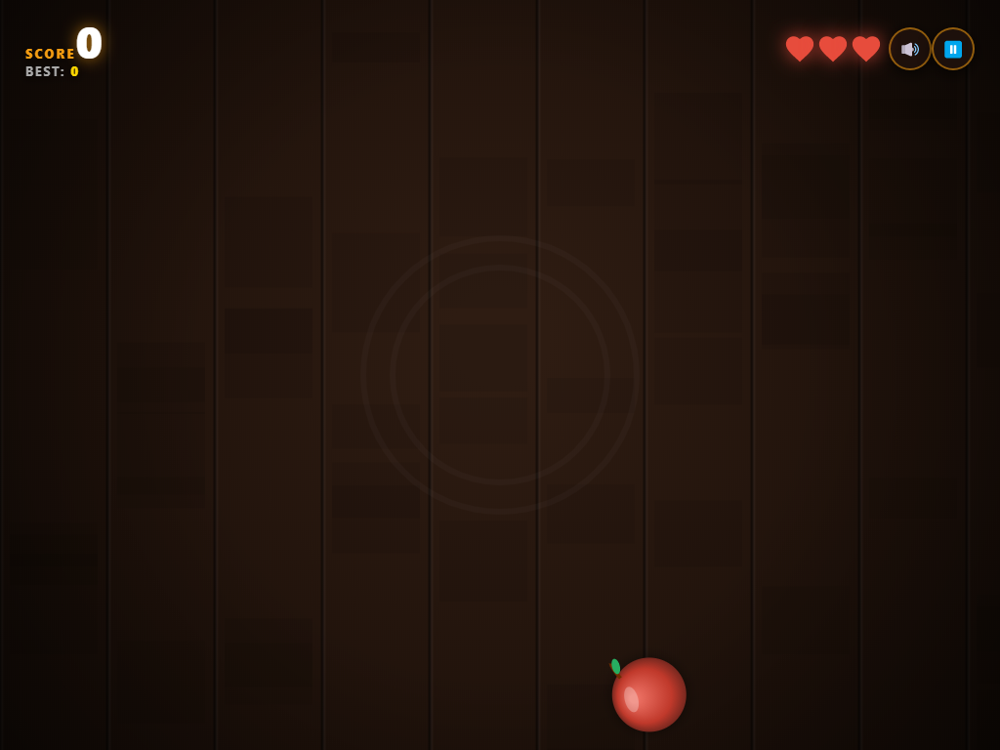

<div align="center">


<br/>


### 🍉 🍊 🍎 🍌 🍍 🍓

**A fast, juicy fruit-slicing arcade game that runs right in your browser.**
No installs. No libraries. Just swipe and slice.

[**▶ Play Now**](https://YOUR_USERNAME.github.io/fruit-blade/) · [**🐞 Report Bug**](https://github.com/YOUR_USERNAME/fruit-blade/issues) · [**💡 Request Feature**](https://github.com/YOUR_USERNAME/fruit-blade/issues)

</div>

---

## 📸 Screenshots

<div align="center">

| Start Screen | Slicing Action | Gameplay |
|:---:|:---:|:---:|
|  |  |  |
| Dojo-style title menu | Glowing cyan blade trail | Fruits flying in the dojo |

</div>

---

## ✨ Features

- 🗡️ **Smooth blade trail**: a glowing cyan slash that follows your mouse or finger
- 🍉 **6 juicy fruits**: watermelon, orange, apple, banana, pineapple and strawberry
- 💥 **Slice physics**: fruits split into two halves with rotation, gravity and juice splashes
- 💣 **Bombs**: slice one and it's game over (or you lose a life)
- ⚡ **Combo system**: slice 3 or more fruits in one swipe for bonus points
- ❤️ **3 lives**: miss a fruit and you lose a heart
- 📈 **Progressive difficulty**: faster launches, bigger waves and more bombs as you score
- 🏆 **High score** saved in `localStorage`
- 🔊 **Web Audio sound effects** (no audio files) with a mute toggle
- ⏸️ **Pause / resume** anytime
- 📱 **Fully responsive**: works on desktop and mobile, touch and mouse

---

## 🎮 How to Play

| Action | Desktop | Mobile |
|---|---|---|
| Slice fruits | Click and drag the mouse | Swipe with your finger |
| Pause | Pause button (top right) | Tap the pause button |
| Mute / unmute | Speaker button | Tap the speaker button |

**Rules**

1. Swipe across fruits to slice them and earn points.
2. Slice **3 or more** fruits in one swipe for a **Combo** bonus.
3. **Avoid the bombs** 💣
4. Don't let fruits fall. Every missed fruit costs you a ❤️
5. Survive as long as you can and beat your best score!

---

## 🚀 Getting Started

### Option 1: Just open it

```bash
git clone https://github.com/YOUR_USERNAME/fruit-blade.git
cd fruit-blade
```

Then double-click `index.html`. That's it. 🎉

### Option 2: Run a local server

```bash
# Python
python -m http.server 8000

# or Node.js
npx serve .
```

Open **http://localhost:8000** in your browser.

---

## 🛠️ Tech Stack

| Technology | Used for |
|---|---|
| **HTML5 Canvas** | Rendering fruits, particles and blade trail |
| **Vanilla JavaScript** | Game loop, physics, collision and input |
| **CSS3** | Menus, HUD and animations |
| **Web Audio API** | Procedural sound effects |
| **localStorage** | Saving the high score |

---

## 📁 Project Structure

```
fruit-blade/
├── index.html          # The entire game (HTML + CSS + JS)
├── screenshots/        # README images
│   ├── screenshot_start.png
│   ├── screenshot_action.png
│   └── screenshot_gameplay.png
└── README.md
```

---

## 🗺️ Roadmap

- [x] Core slicing gameplay
- [x] Combos and high score
- [x] Sound effects and mute toggle
- [x] Mobile touch support
- [ ] Power-ups (freeze banana, double points)
- [ ] Game modes (Classic, Arcade, Zen)
- [ ] Online leaderboard
- [ ] Blade skins and themes
- [ ] Achievements

---

## 🌐 Deploy on GitHub Pages

1. Push this project to a GitHub repository.
2. Go to **Settings → Pages**.
3. Under **Source**, choose the `main` branch and `/ (root)` folder.
4. Click **Save**. Your game goes live at `https://YOUR_USERNAME.github.io/fruit-blade/`

---

## 🤝 Contributing

Contributions are welcome!

1. Fork the project
2. Create your branch: `git checkout -b feature/amazing-feature`
3. Commit your changes: `git commit -m "Add amazing feature"`
4. Push to the branch: `git push origin feature/amazing-feature`
5. Open a Pull Request

---

## 📄 License

Distributed under the **MIT License**. See `LICENSE` for more information.

---

<div align="center">

### ⭐ If you enjoyed Fruit Blade, give it a star!

Made with 🍉 and ❤️ by **[YOUR_NAME](https://github.com/YOUR_USERNAME)**


</div>
